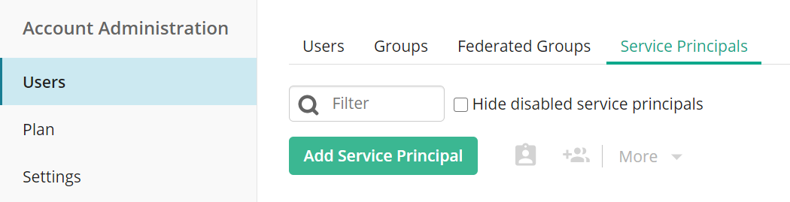
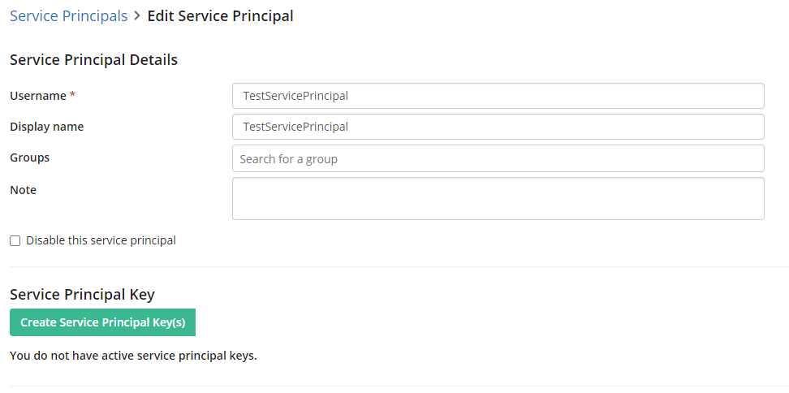
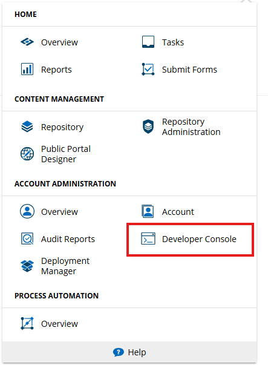
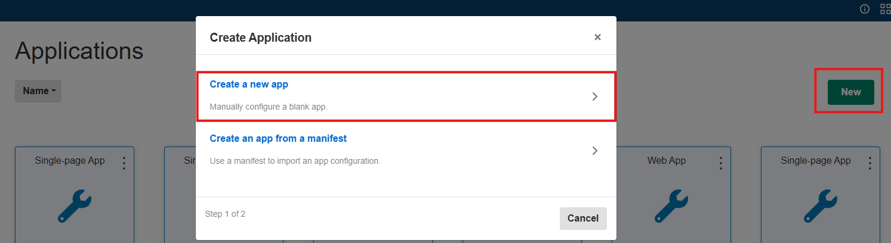
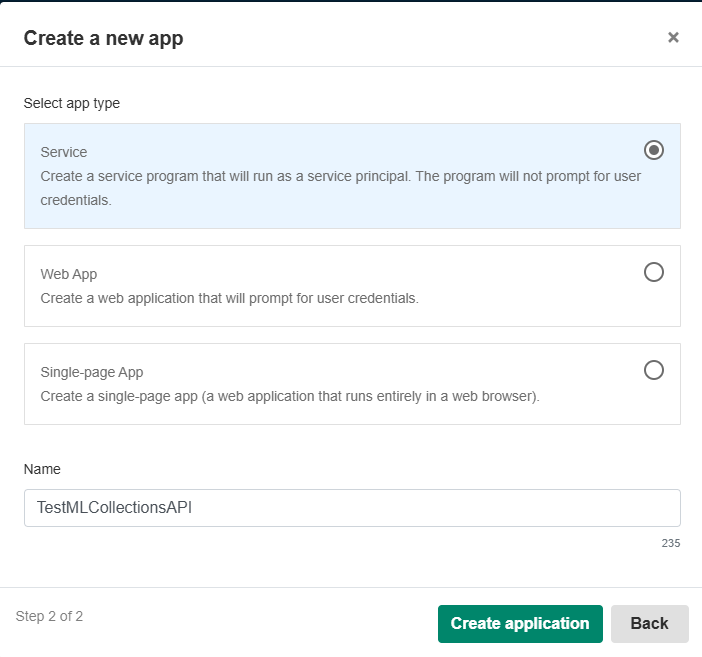
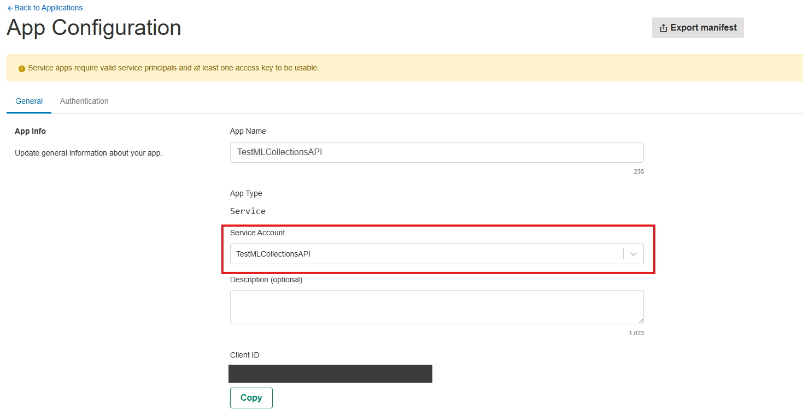
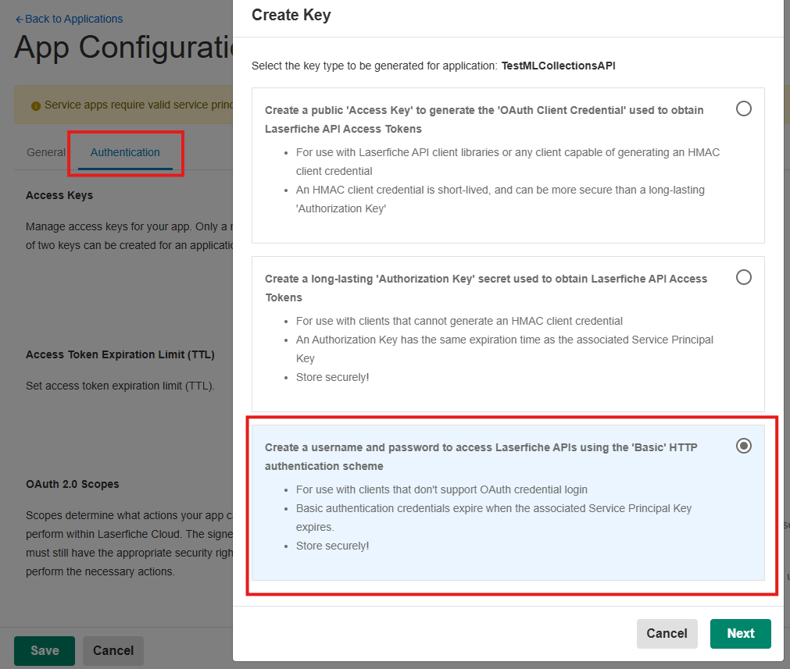
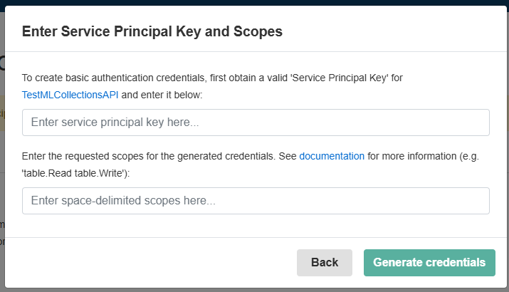
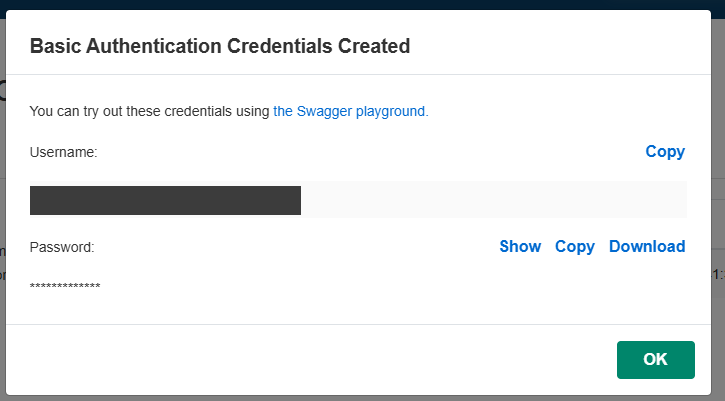

<!--© 2026 Laserfiche.
See LICENSE-DOCUMENTATION and LICENSE-CODE in the project root for license information.-->

# Collections API
**Applies to**: Laserfiche Cloud.

A **collection** is a named set of documents that you upload through this API. The service extracts the text from each document, splits it into passages, and indexes them so you can ask questions in natural language. Each answer cites the passages it came from.

- Collections hold only content you upload through this API. They are not linked to repository entries, and nothing from a repository is added to them automatically.
- Collections belong to the Laserfiche Cloud **account**. Every Collections API credential in the account can list, change, query, and delete every collection in that account.
- The Collections API is available in the United States, Canadian, and European Cloud data centers. Self-hosted Laserfiche does not have it.

## Base URLs

Use the data center where your Laserfiche Cloud account resides.

| Data center   | Base URL                                          | Swagger UI                                                    |
| ------------- | ------------------------------------------------- | ------------------------------------------------------------- |
| United States | `https://api.laserfiche.com/ai/collections/v1`    | [Try it](https://api.laserfiche.com/ai/collections/v1/ui/)    |
| Canada        | `https://api.laserfiche.ca/ai/collections/v1`     | [Try it](https://api.laserfiche.ca/ai/collections/v1/ui/)     |
| Europe        | `https://api.eu.laserfiche.com/ai/collections/v1` | [Try it](https://api.eu.laserfiche.com/ai/collections/v1/ui/) |

## Authentication

{: .important }
The Collections API accepts only **HTTP Basic authentication** with a username and password that you generate in the Developer Console. It does not accept OAuth access tokens. A request that sends `Authorization: Bearer <token>` gets `401 Unauthorized`.

Send the credentials on every request:

```
Authorization: Basic base64(username:password)
```

- **Scopes are not used.** Leave **Requested scopes** empty when you generate the credentials. A value in that field does not change what the credentials can do in the Collections API. The API does not check any OAuth 2.0 scope, including `collections.All`. See [OAuth 2.0 scopes](../authentication/guide_oauth_2.0_scopes/#collections-api).
- **Access covers the whole account.** The credentials reach every collection in the account. The service principal's repository access rights do not apply, because collections are not stored in a repository.
- **Credentials expire with their key.** The username and password stop working when the service principal key they were generated from expires or is rotated. Service principal keys expire after 90 days by default. To renew, generate new credentials from a valid key ([step 3](#step-3-generate-the-username-and-password)) and update your integration. A Service app can hold two access keys, so you can switch to new credentials before the old key expires.

## Set up credentials

{: .note }
**Note:** Access to the Developer Console requires the _Developer Console Administrator_ role. Creating or modifying an OAuth Service App requires the _Trustee Administration_ role. Set roles from the Laserfiche Cloud Account Administration site.

### Step 1: Create a service principal and key

1. In Account Administration, open the **Users** tab and go to **Service Principals**. Click **Add Service Principal**, or open an existing service principal. 
1. Click **Create Service Principal Key(s)** and save one of the keys. The keys are shown only once. 

See the [Service Principals guide](../authentication/guide_service-principals/) for more about creating principals and rotating keys.

### Step 2: Register a Service app

1. Open the [Developer Console](../../getting-started/developer-console/). 
1. Click **New**, then **Create a new app**. 
1. Select **Service**, enter a name, and click **Create application**. 
1. On the **General** tab, select the service principal from step 1 in **Service Account**, and save. 

### Step 3: Generate the username and password

1. On the **Authentication** tab, create a key and choose **Create a username and password to access Laserfiche APIs using the 'Basic' HTTP authentication scheme**. Click **Next**. 
1. Paste the service principal key from step 1. **Leave the requested scopes empty**, and click **Generate credentials**. 
1. Copy or download the username and password. The password is shown only once. The username is the app's Client ID. 

### Step 4: Make a first call

```sh
curl -u "username:password" https://api.laserfiche.com/ai/collections/v1/usage
```

```json
{
  "remaining_usage_bytes": 1073741824,
  "limit_bytes": 1073741824,
  "collections": []
}
```

In the Swagger UI, click **Authorize** and enter the same username and password.

## Endpoints

Paths are relative to the [base URL](#base-urls). `{collection}` is the collection name.

| Operation                       | Purpose                               | Request                                                              | Success response                                                     |
| ------------------------------- | ------------------------------------- | -------------------------------------------------------------------- | -------------------------------------------------------------------- |
| `POST /{collection}`            | Create a collection                   | No body                                                              | `200` with a confirmation string                                     |
| `GET /{collection}`             | List the documents in a collection    | No body                                                              | `200` with `{"<document name>": <bytes>, ...}`                       |
| `DELETE /{collection}`          | Delete a collection and its documents | No body                                                              | `204`                                                                |
| `POST /{collection}/document`   | Add or replace documents              | `multipart/form-data` with `files` parts, or JSON `{"name", "text"}` | `200` with a confirmation string                                     |
| `DELETE /{collection}/document` | Delete documents by name              | Query string: `?documents=a.pdf&documents=b.docx`                    | `200` with a confirmation string                                     |
| `POST /{collection}/query`      | Ask a question                        | JSON `{"input_prompt"}`                                              | `200` with `{"response_id", "answer", "references"}`                 |
| `GET /usage`                    | Show storage used and remaining       | No body                                                              | `200` with `{"limit_bytes", "remaining_usage_bytes", "collections"}` |

The confirmation strings are informational. Check the status code, and don't parse the text.

### Names

- Collection names and document names are case-sensitive.
- Use URL-safe collection names: letters, digits, `-`, and `_`. URL-encode anything else.
- All integrations in an account share one set of collection names. Two integrations that use the same name write to the same collection.

### Create a collection

`POST /{collection}` returns `200` with `"Success"`. If the collection already exists, it returns `200` with `"Collection (<name>) already exists."` and leaves the collection unchanged, so it is safe to call before every upload.

### Add or replace documents

`POST /{collection}/document` accepts either form:

- **Files:** `multipart/form-data` with one or more parts named `files`. Each part's file name becomes the document name.
- **Text:** JSON `{"name": "<document name>", "text": "<content>"}`. Use this to push text from another system.

A document whose name already exists in the collection is **replaced**. If the request fails, the collection is left as it was.

The collection must already exist. Uploading to a collection that does not exist returns `404`.

The service skips any file it cannot read: an unsupported or oversized file, or a file with no text layer (see [Limits](#limits)). The `200` response does not name skipped files. Call `GET /{collection}` afterward to confirm what was stored. If no file in the request produces text, the request fails with `400` and `error_code` `106` ("No vectorizable text was found").

### List documents

`GET /{collection}` returns each document name with the size of its extracted text in bytes. That is the size that counts toward storage, not the file size. A collection that does not exist returns `200` with `{}`.

### Delete documents

`DELETE /{collection}/document` takes one `documents` query parameter per document name. Names that are not in the collection are ignored. Deleting documents frees their storage.

### Ask a question

`POST /{collection}/query` takes `{"input_prompt": "<question>"}` and returns:

| Field         | Description                                                                                                                                       |
| ------------- | ------------------------------------------------------------------------------------------------------------------------------------------------- |
| `response_id` | A 32-character hexadecimal identifier for this response.                                                                                          |
| `answer`      | The answer, in Markdown. In-text citations such as `[1]` refer to `references[0]`, `[2]` to `references[1]`, and so on.                           |
| `references`  | The passages the answer cites, in citation order. Each has `source` (the document name) and `content` (the passage text). The list can be empty. |

- The answer uses only the collection's documents. If they don't contain the answer, the response says so rather than guessing.
- Answers are in English unless the question asks for another language.
- Each question is answered on its own. The API keeps no conversation history, so include any context a follow-up question needs.
- Each successful query uses **1 AI unit**. Other operations don't use AI units.

### Show storage usage

`GET /usage` returns the account's storage limit, what remains, and the size of each collection:

```json
{
  "remaining_usage_bytes": 1073183291,
  "limit_bytes": 1073741824,
  "collections": [
    {
      "collection_name": "hr-policies",
      "collection_id": "3f1c2a8e-5d47-4b8a-9a61-0c2e7d9b4f10",
      "total_bytes": 558533
    }
  ]
}
```

## Limits

| Limit                | Value                                                                                 | When exceeded                                                                          |
| -------------------- | ------------------------------------------------------------------------------------- | -------------------------------------------------------------------------------------- |
| Storage              | 1 GiB (1,073,741,824 bytes) of **extracted text** per account, across all collections | The upload fails with `400`, `error_code` `1143`. Nothing from that request is stored. |
| Request size         | 100 MiB per request body                                                              | `413`                                                                                  |
| PDF and Office files | 50 MiB per file                                                                       | The file is skipped.                                                                   |
| AI units             | 1 per successful query                                                                | `429`, `error_code` `123`, once the account's AI units are used up                     |

Storage counts the UTF-8 bytes of the text extracted from each document, not the size of the file. Deleting documents or collections frees storage.

**Supported files:** plain text (`.txt`), PDF, Microsoft Word, Excel, PowerPoint, Outlook (`.msg`), OneNote, Publisher, and Visio files, OpenDocument text and spreadsheets, RTF, HTML, XML, CSV, and other text-based formats.

{: .warning }
The Collections API does **not** perform OCR. Image files and scanned PDFs without a text layer produce no text and are skipped. Run OCR first, or send the text with the JSON form.

## Errors

Errors return a JSON body:

```json
{
  "title": "Not Found",
  "detail": "Collection 'hr-policies' does not exist",
  "status": 404,
  "error_code": 1142
}
```

| Status | `error_code`         | Meaning                                                                                                   |
| ------ | -------------------- | --------------------------------------------------------------------------------------------------------- |
| `400`  | `106`                | No text could be extracted from any file in the request, or the JSON `name` is empty.                     |
| `400`  | `1143`               | The upload would exceed the account's storage limit. Delete documents or collections to free space.       |
| `400`  | none                 | The request does not match the API schema, for example a missing `input_prompt` or `documents` parameter. |
| `401`  | none                 | No `Authorization` header, or a Bearer token instead of Basic credentials.                                |
| `401`  | `111`                | The username or password is wrong, or the service principal key behind it has expired or been rotated.    |
| `403`  | `107`                | The Collections API is not enabled for the account. Contact Laserfiche support.                           |
| `403`  | `103`                | The service is not available in the caller's location.                                                    |
| `403`  | `124`                | Query only: the account has no AI-unit allowance.                                                         |
| `404`  | `1142`               | The collection does not exist (upload, document delete, and query).                                       |
| `413`  | none                 | The request body is over 100 MiB.                                                                         |
| `429`  | `123`                | Query only: the account has used all of its AI units.                                                     |
| `500`  | `1150`–`1158`, other | A server or AI model error. Retry with backoff.                                                           |

## Examples

These examples use `curl` against the United States data center. Set two variables first:

```sh
export LF_API=https://api.laserfiche.com/ai/collections/v1
export LF_AUTH='username:password'   # from step 3 of the setup
```

Sample responses are illustrative. Token counts, sizes, IDs, and answers will differ.

### Answer policy questions from files

Create a collection, upload a handbook and a policy, and ask a question.

```sh
curl -u "$LF_AUTH" -X POST "$LF_API/hr-policies"
```

```json
"Success"
```

```sh
curl -u "$LF_AUTH" -X POST "$LF_API/hr-policies/document" \
  -F "files=@Employee-Handbook.pdf" -F "files=@PTO-Policy.docx"
```

```json
"Successfully inserted into vectordb with 131877 tokens"
```

```sh
curl -u "$LF_AUTH" -X POST "$LF_API/hr-policies/query" \
  -H "Content-Type: application/json" \
  -d '{"input_prompt": "How many PTO days do new employees get?"}'
```

```json
{
  "response_id": "9b2f6c0e4a7d4f1b8e3c5a2d1f0e9c8b",
  "answer": "Based on the provided information, new full-time employees accrue 15 days of PTO per year, prorated in their first year [1].",
  "references": [
    {
      "source": "PTO-Policy.docx",
      "content": "Full-time employees accrue 15 days of paid time off per calendar year. Employees hired after January 1 receive a prorated amount for their first year..."
    }
  ]
}
```

The same flow in Python with `requests`:

```python
import requests

API = "https://api.laserfiche.com/ai/collections/v1"
AUTH = ("username", "password")  # from step 3 of the setup

requests.post(f"{API}/hr-policies", auth=AUTH).raise_for_status()

with open("Employee-Handbook.pdf", "rb") as handbook, open("PTO-Policy.docx", "rb") as pto:
    requests.post(
        f"{API}/hr-policies/document",
        auth=AUTH,
        files=[("files", ("Employee-Handbook.pdf", handbook)), ("files", ("PTO-Policy.docx", pto))],
    ).raise_for_status()

response = requests.post(
    f"{API}/hr-policies/query",
    auth=AUTH,
    json={"input_prompt": "How many PTO days do new employees get?"},
)
response.raise_for_status()
result = response.json()
print(result["answer"])
for number, reference in enumerate(result["references"], start=1):
    print(f"[{number}] {reference['source']}")
```

### Push text from another system

Send ticket resolutions, knowledge-base articles, or Workflow output as text. Posting again with the same `name` replaces that document.

```sh
curl -u "$LF_AUTH" -X POST "$LF_API/it-kb"
curl -u "$LF_AUTH" -X POST "$LF_API/it-kb/document" \
  -H "Content-Type: application/json" \
  -d '{"name": "KB-1042-vpn-reset", "text": "To reset the VPN client, ..."}'
```

```json
"Successfully inserted into vectordb with 214 tokens"
```

### Keep a collection in sync

List the documents, delete the ones that were retired, and upload changed files again under the same name.

```sh
curl -u "$LF_AUTH" "$LF_API/hr-policies"
```

```json
{
  "Employee-Handbook.pdf": 512870,
  "PTO-Policy.docx": 45663
}
```

```sh
curl -u "$LF_AUTH" -X DELETE \
  "$LF_API/hr-policies/document?documents=PTO-Policy.docx&documents=Old-Travel-Policy.pdf"
```

```json
"Succesfully deleted documents: ['PTO-Policy.docx', 'Old-Travel-Policy.pdf']"
```

### Check storage before a bulk load

Call `GET /usage` before a large upload, and alert when `remaining_usage_bytes` runs low.

```sh
curl -u "$LF_AUTH" "$LF_API/usage"
```

The response has the shape shown in [Show storage usage](#show-storage-usage).

### Retire a collection

Deleting a collection removes all of its documents and frees its storage.

```sh
curl -u "$LF_AUTH" -X DELETE "$LF_API/hr-policies"
```

The response is `204 No Content`.

## Related

- [Creating an OAuth Service App](../authentication/guide_oauth-service/)
- [Service Principals](../authentication/guide_service-principals/)
- [Authenticating to the Swagger Playground](../authentication/guide_authenticating-to-the-swagger-playground/)
- [OAuth 2.0 Scopes](../authentication/guide_oauth_2.0_scopes/#collections-api)
